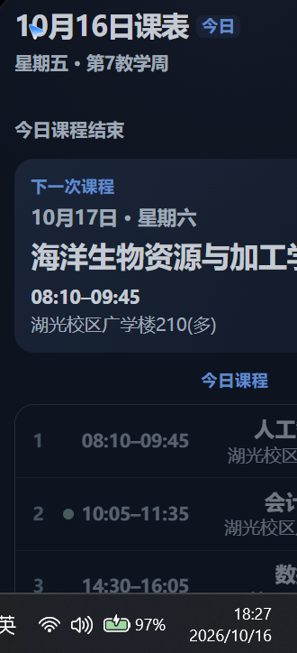
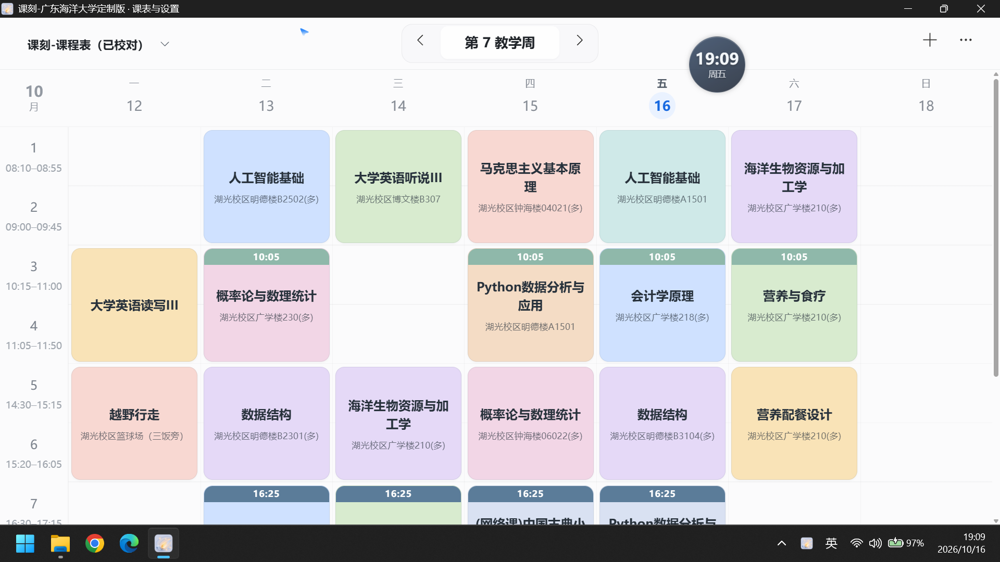
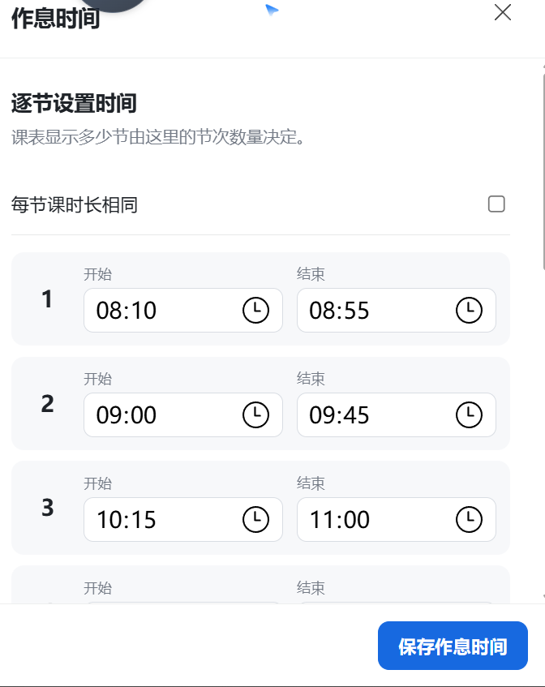
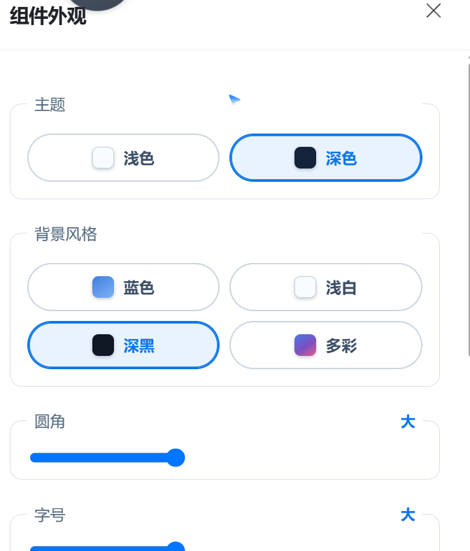
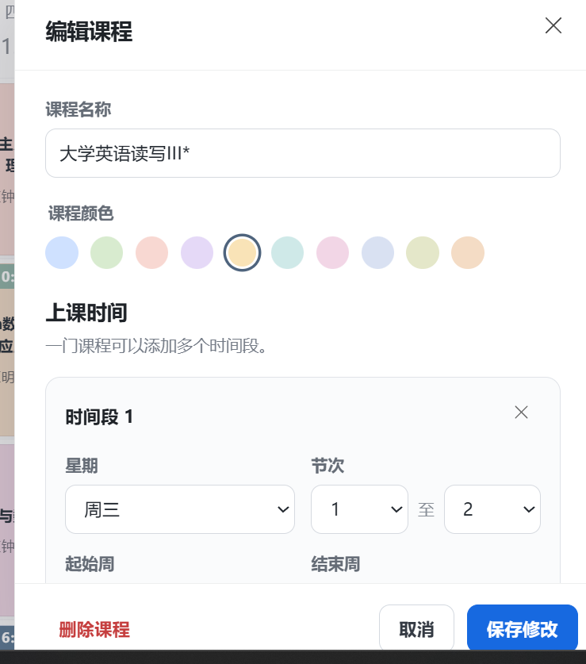
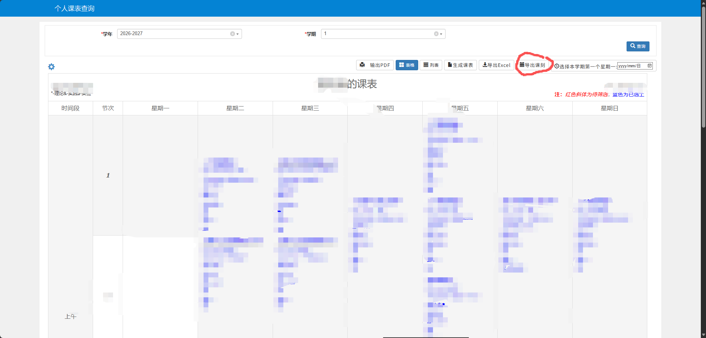

# 课刻-广东海洋大学定制版 

> 基于 [Tyr1onX/desktop-course-widget](https://github.com/Tyr1onX/desktop-course-widget)深度定制的桌面课表组件，适配广东海洋大学教务系统。

<div align="center">

<p align="center">
  
</p>

**让一天在桌面上缓慢流动。**

从教务系统导入课表，在 Windows 桌面查看当前课程、下一节与完整周课表；针对广海作息、教学楼特殊节次做了本地化定制。

Windows 10 / 11 · 免费开源 · 无需账号 · 数据只保存在本机

</div>

## 功能演示

| 悬浮球（桌面组件） | 今日课程卡片 | 课表周视图 |
| --- | --- | --- |
|  |  |  |

| 作息时间设置 | 特殊标注规则 | 组件外观设置 |
| --- | --- | --- |
|  |  |  |

| 编辑课程 | 使用帮助 |
| --- | --- |
|  |  |


## 配套脚本：GDOU_课表导出_ICS_Excel.user.js

适用于广东海洋大学（GDOU）教务系统的一键导出脚本，与"课刻"搭配使用：脚本负责从教务系统导出标准 Excel 课表，软件负责导入并生成桌面组件。

**安装方式**：在浏览器安装暴力猴（Violentmonkey）等油猴脚本管理器，导入本脚本后，打开教务系统"个人课表查询"页面，功能栏会出现"导出课刻"按钮：



**使用流程**：打开https://wfw.gdou.edu.cn/ →查询信息→个人课表查询→选定学年学期 → 选择本学期第一个星期一 → 点击"导出课刻" → 得到标准 Excel 课表 → 在"课表与设置"中导入，即可生成桌面组件。

## 相对原版新增的功能

1. **特殊节次时间标注**：为特定教学楼（如广学楼、明德楼）的课程，在课程卡片顶部标注实际上课时间（如第 2 大节实际 10:05–11:35，而非 10:15–11:50）。规则可自定义：任意关键词、任意节次、任意实际时间，随软件内置 2 条广海默认规则（可删除）。
2. **大节合并显示**：课表按"两个时间段 = 一大节"合并，课程卡片占满两个格子；左侧节次栏仍按每个时间段单独编号。
3. **今日课程时间同步**：桌面组件的今日课程严格按作息时间映射，并自动扩展单节课程为完整大节；特殊规则修改后组件实时联动。
4. **桌面形态独立切换**：悬浮球 ↔ 桌面卡片切换只影响组件本身，不影响课表主窗口；系统托盘单击切换窗口显隐、双击打开/收起设置窗口。
5. **组件外观全面可调**：主题（深黑/浅色）、背景风格、圆角、字号（三档）、透明度 0–100%（100% 完全实体）、应用内课程字号自定义。
6. **PDF 课表导入**：在原版 Excel 导入、截图 OCR 基础上新增 PDF 导入管线。
7. **体验细节打磨**：悬浮球正圆+柔和阴影、展开动画、窗口跨屏拖动不越界不吸附、设置页保持滚动位置、隐藏滚动条、帮助页重排、去 AI 注释等。

详细差异见 [差异说明.md](差异说明.md)。

## 快速开始

1. 从 GitHub Release 下载任一版本：`Keke-GDOU-Custom_v1.0.0_portable.exe`（免安装单文件，双击即用）、`Keke-GDOU-Custom_v1.0.0_green.zip`（解压即用）或 `Keke-GDOU-Custom_v1.0.0_setup.exe`（安装版）。文件名中的中文会被 GitHub 平台过滤，故 Release 附件统一使用英文名。
2. 启动"课刻-广东海洋大学定制版"，打开"课表与设置"。
3. 用 GDOU_课表导出_ICS_Excel.user.js 从教务系统导出 `.xlsx`，在"导入新课表"中选择并导入。
4. 检查导入结果，创建并应用课表。

> 当前安装包未进行商业代码签名，Windows 可能提示"未知发布者"，选择"更多信息 → 仍要运行"即可。

## 数据与隐私

课表文件只在本机处理，不收集、不上传任何课程数据，无需登录账号。数据目录：

```text
%LOCALAPPDATA%\com.coursewidget.desktop\
```

- `schedule.json`：桌面组件使用的当前课表
- `settings.json`：作息时间、组件外观、特殊标注规则和应用设置
- `schedules/index.json` 与 `schedules/*.json`：多课表索引与数据
- `backups/`：数据迁移或覆盖时留下的备份

## 当前限制

- 仅支持 Windows 10 / 11，依赖系统 WebView2 运行时（Win10/11 一般已内置）。
- 截图/PDF 识别仍需清晰完整包含星期栏、节次、课程区域的输入。
- 暂不支持课程通知、云同步和应用内自动更新。

## 本地开发

需要 Node.js、Rust、Windows WebView2 与 MSVC/GNU C++ 构建工具链。

```powershell
npm install
npm run tauri:dev        # 开发模式
npm run tauri:build      # 构建安装包
```

## 开源许可

本项目基于 [MIT License](LICENSE) 开源，保留原项目作者版权。

- 原项目：[Tyr1onX/desktop-course-widget](https://github.com/Tyr1onX/desktop-course-widget)（课刻）
- 定制版作者：权爷
